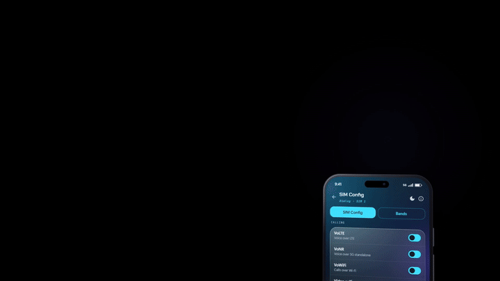

# Pixel IMS 5G

IMS controls, radio configuration and live network diagnostics for Google Tensor Pixel phones, with **Root** and **Shizuku** backends.

[**Download 2.2.6**](https://github.com/barrylk/Pixel-IMS-5G/releases/download/v2.2.6/Pixel-IMS-5G-v2.2.6.apk) · [Release notes](https://github.com/barrylk/Pixel-IMS-5G/releases/tag/v2.2.6) · [Install and update guide](docs/release-guide.md) · [Changelog](CHANGELOG.md) · [Report an issue](https://github.com/barrylk/Pixel-IMS-5G/issues)

  
   
  <a href="https://github.com/barrylk/Pixel-IMS-5G/blob/main/assets/promo/pixel-ims-5g-promo.mp4">Watch the promo with sound</a> · <a href="https://github.com/barrylk/Pixel-IMS-5G/blob/main/assets/promo/pixel-ims-5g-promo-vertical.mp4">9:16 vertical</a>

## Current release: 2.2.6

**2.2.6 combines the working 2.2.5 root compatibility build with the fixes published separately in 2.2.1.** It uses version code **38** and application ID `com.nirmala.pixel5gims`.

| Included changes | What they do |
| --- | --- |
| Root compatibility from 2.2.5 | Preserves shell-resolved root startup, queued permission requests and Binder identity handling for the privileged service |
| KernelSU / KernelSU Next module support | Mounts only `cfg.db` at boot without a mounting metamodule, with hash and SELinux checks, a read-only remount and rollback on failure |
| Existing Magisk and APatch support | Retains their systemless module installation paths |
| Patch readiness and revalidation | Distinguishes active, staged, stale and failed patches, including firmware changes |
| Callback reporting from 2.2.1 | Separates failed registration from successful registration that delivered no callback events |
| Evidence warnings from 2.2.1 | Separates missing serving cells, conflicting CellInfo and unmatched device-global physical channels |

The optimized release APK is signed with the established public release identity. Both build variants and **53 unit tests** passed. The published APK's version, checksum and signature were verified after download; see the [verification details](docs/release-guide.md#public-apk-verification).

## Requirements and access

The app targets Tensor Pixels from Pixel 6 through Pixel 10 and includes support for Android 16 and Android 17. Device, firmware and carrier behavior varies. Development and field testing have included a Pixel 7 Pro running Android 17; this does not establish validation of every model or carrier.

| Backend | Available scope |
| --- | --- |
| Root: Magisk, KernelSU / KernelSU Next, or APatch | Supported IMS and radio controls, privileged diagnostics, and regional modem patch installation through the module manager |
| Shizuku | Supported Android-side IMS and radio configuration and diagnostics; cannot install or mount the vendor modem database |

KernelSU users must grant Superuser access to Pixel IMS 5G. This app's single-file modem module does not require a mounting metamodule. Band and radio requests still depend on what the firmware exposes and accepts.

## Install or update

1. Download [Pixel-IMS-5G-v2.2.6.apk](https://github.com/barrylk/Pixel-IMS-5G/releases/download/v2.2.6/Pixel-IMS-5G-v2.2.6.apk).
2. Install it over an existing public GitHub release, or install it as a new app.
3. Open Pixel IMS 5G, choose Root or Shizuku and approve access in that manager.
4. Select the intended SIM and review Setup. Start with **Automatic** bands and a normal LTE + NR preference.
5. Use the action offered for a failing Setup check, then inspect the actual network state.

**Locally signed 2.2.5 test builds need a 2.2.6 APK signed with their original local key.** Android will reject the public APK as an in-place update if the installed app uses a different certificate. See the [update guide](docs/release-guide.md#choose-the-correct-apk) before uninstalling anything.

## Regional modem patch

The experimental patch validates the current Tensor firmware database, patches a copy and stages a reversible module. It does not write modem NV/EFS or spoof SIM, PLMN or Wi-Fi country values.

- **KernelSU / KernelSU Next:** the boot module binds only `/vendor/firmware/carrierconfig/cfg.db`, validates hashes and SELinux labels, and remounts it read-only. Mount validation failures trigger rollback and a recorded status.
- **Magisk / APatch:** the existing systemless module installation path is retained.
- **Firmware changes or an inactive old KernelSU overlay:** use **Revalidate for this firmware**, review the confirmation, install and reboot when requested.
- **After reboot:** require **Patch active** in the app before treating the patch as mounted. An installed module alone does not prove activation.

Mounting the database does not prove the network accepted an NR connection. Coverage, carrier provisioning, hardware support and network policy still determine whether 5G attaches.

## Features

- **Setup checks:** access, SIM and IMS readiness, NR settings, band selection, modem patch state and observed connectivity, with actions for checks that need attention.
- **Per-SIM controls:** VoLTE, VoWiFi, VoNR, NSA/SA configuration, CarrierConfig editing, IMS restart and recovery.
- **Bands and LTE+:** automatic bands, supported LTE/NR restrictions, carrier-aggregation diagnostics and Easy Mode. The modem and network select the actual serving bands and CA combination.
- **Live network monitoring:** serving and nearby cells, LTE anchors and NR evidence, signal measurements and history, and radio-state transitions.
- **Field-test exports:** timed samples, callback timelines, NR/EN-DC state, relevant CarrierConfig values and available sanitized root diagnostics.
- **Root tools:** VoWiFi repair, status-bar indicators, privileged evidence and reversible Android-side radio configuration.
- **Updates and interface:** GitHub release checks and downloads, light/dark/system themes and the liquid-glass interface.

## Check whether 5G is connected

Use Network monitoring or the standard field test while mobile data is enabled. The app distinguishes LTE carrier aggregation, advertised NR availability, active NSA and active SA.

A **5G status-bar icon**, **NR available** flag or **mounted patch** alone does not establish an active 5G connection. Look for connected NR state or serving NR evidence. Field-test reports now explain missing observations, cross-SIM conflicts and unmatched physical-channel snapshots separately.

Keep bands automatic for initial testing. SA/NR-only settings can remove calls, SMS or data where standalone service is unavailable. Use Undo or the app's recovery controls if a change removes service.

### Earlier field result

An earlier Dialog Sri Lanka capture on a Pixel 7 Pro recorded LTE B3 + B1 + B41 aggregation with an n78 NSA secondary cell. These images are historical field evidence, not a new 2.2.6 acceptance test or a speed guarantee.

| NSA field capture | Speed test from that field session |
| --- | --- |
|  |  |

## Troubleshooting

| Symptom | First checks |
| --- | --- |
| Root does not connect | Confirm the app's Superuser permission and profile in the root manager, then retry |
| KernelSU patch installed but inactive | Read the boot-mount status; revalidate an old overlay or changed firmware, then reboot |
| APK will not update the installed app | Check signing identity; a locally signed test build needs its original key |
| 5G icon but LTE measurements | Run a field test and inspect connected NR / serving NR evidence |
| Service lost after changing bands or mode | Restore Automatic bands or use Undo/recovery |
| Shizuku settings unavailable | Start Shizuku and confirm the app has permission |

Reports exclude phone number, IMSI and ICCID, but cell IDs and measurements can indicate approximate location. Review exports before sharing them in [issues](https://github.com/barrylk/Pixel-IMS-5G/issues).

## Build and documentation

Build with **JDK 17**, Android SDK **36**, build tools **36.0.0** and the full Android 36 API jar required for hidden telephony APIs. The release variant uses R8 and resource shrinking.

- [Build and signing instructions](docs/building.md)
- [Install, update and APK verification](docs/release-guide.md)
- [Complete changelog](CHANGELOG.md)
- [2.2.6 source reconciliation and validation](docs/release-2.2.6-provenance.md)
- [Technical overview](PIXEL_IMS_5G.md)

## Developer and support

Developed by **Nadeeja Nirmala**.

[GitHub](https://github.com/barrylk) · [Facebook](https://www.facebook.com/nirmalafromslk/) · [Bug reports and feedback](https://github.com/barrylk/Pixel-IMS-5G/issues)

## Origin and license

Pixel IMS 5G is based on the original GPL project [kyujin-cho/pixel-volte-patch](https://github.com/kyujin-cho/pixel-volte-patch) and the work of its community contributors. Tensor wildcard/PTCRB `cfg.db` mapping research is credited to [vchikalkin/Pixel-Modem-Fix](https://github.com/vchikalkin/Pixel-Modem-Fix) and [Displax/modem-fix](https://github.com/Displax/modem-fix). This app independently validates and patches the current firmware database and does not redistribute either project's database or binary tools.

This modified project remains licensed under the GNU General Public License v3.0. See [LICENSE](LICENSE). Pixel is a trademark of Google LLC. This is an unofficial community project and is not affiliated with Google or any mobile carrier.
